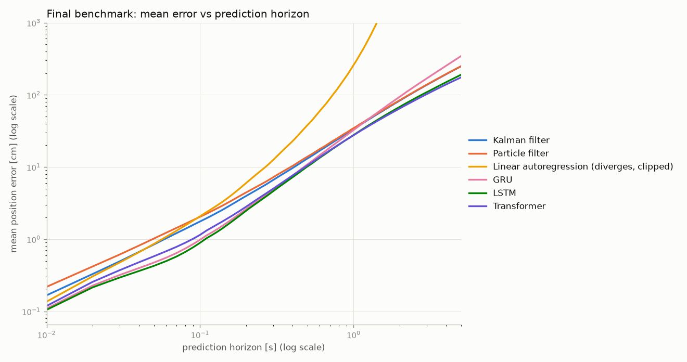
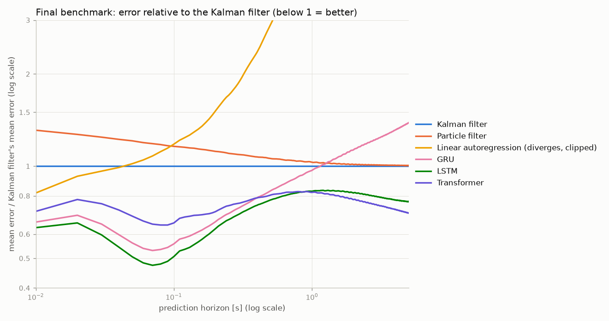

# Final benchmark

This benchmark compares the best configuration of every algorithm tested in the project, side by side, on the
same data. How each one was found: [ALGORITHMS.md](../../ALGORITHMS.md). All tables: [tables.md](tables.md).
Regenerate with `python -m Algorytms.benchmark`.

**How the test works:**

- **Test set:** the 20 benchmark trajectories, 17.2 min of flight at 100 frames per second.
- **Prediction points:** every measured frame after 1 s of history, ~72 000 per horizon.
- **Horizons:** 10 ms to 5 s.
- **Error:** distance between the predicted and the true position, in cm. Only measured positions count as truth.
- **No test-set tuning:** every model was tuned and selected on training and validation data only, never on these
  trajectories.

## Participants

| algorithm | selected configuration | how it was selected | results |
|---|---|---|---|
| Kalman filter | constant velocity, setting 0.336 m/s | best of 10 settings; the constant-acceleration model was rejected | [kalman/cv_0.336mps](../kalman/cv_0.336mps/summary.md) |
| Particle filter | 5 000 particles, classic resampling, 0.504 m/s, likelihood 0.2 cm | best of 60 noise pairs and 36 particle-count × elite-fraction settings | [particle/best](../particle/best/summary.md) |
| Linear autoregression | next displacement from the last 20 (least squares) | single model | [baselines/linear_ar](../baselines/linear_ar/summary.md) |
| GRU | velocity input, hidden 32, window 0.2 s, 10 displacements at once (4 542 parameters) | best of 10 GRU networks (4 input representations, 6 experiments) | [gru/disp_h32_k10](../gru/disp_h32_k10/summary.md) |
| LSTM | velocity + acceleration input, hidden 32, window 0.2 s, 10 at once (6 110 parameters) | LSTM vs GRU study, 7 variants × 5 seeds; seed by validation loss | [lstm/best](../lstm/best/summary.md) |
| Transformer | Pre-LN encoder, d 20, window 1 s in 10 patches, 10 at once (4 910 parameters) | 3 variants × 5 seeds; seed by validation loss | [transformer/best](../transformer/best/summary.md) |

## Main result: mean error [cm]

| model | 0.01 s | 0.1 s | 0.2 s | 0.5 s | 1 s | 2 s | 5 s |
|---|---|---|---|---|---|---|---|
| Kalman filter | 0.17 | 1.76 | 3.98 | 13.09 | 33.6 | 83.5 | 248 |
| Particle filter | 0.22 | 2.05 | 4.45 | 13.87 | 34.6 | 84.5 | 249 |
| Linear autoregression | 0.14 | 2.08 | 6.04 | 37.87 | 259 | 6 270 | diverges |
| GRU | 0.11 | 0.98 | 2.62 | 10.87 | 32.6 | 94.5 | 343 |
| **LSTM** | **0.11** | **0.89** | **2.49** | **10.15** | 27.8 | 68.3 | 190 |
| **Transformer** | 0.12 | 1.15 | 2.83 | 10.53 | **27.6** | **65.0** | **174** |

**Best model per horizon:**

| horizons | best model |
|---|---|
| 10 ms – 0.86 s | LSTM |
| 0.87 s – 5 s | Transformer |

## Conclusions

1. **Short horizons belong to the LSTM.**
   - At 0.1 s it is twice as accurate as the Kalman filter: 0.89 vs 1.76 cm mean, 0.71 vs 1.50 cm median.
   - At 0.5 s it is still 22 % better: 10.2 vs 13.1 cm.
   - 99.8 % of its 0.1 s predictions are within 5 cm.
   - With the GRU, the three networks are the three best models up to ~1 s. Predicting 10 frames at once and
     learning how the flight continues beats any constant-velocity model.

2. **Long horizons belong to the transformer.**
   - From 0.87 s on it has the lowest mean error: 27.6 cm at 1 s, 1.74 m at 5 s, 30 % below the Kalman filter.
   - It is also the most robust: its worst case at 5 s is 5.3 m, against 9.4 m for the Kalman filter and 7.8 m
     for the LSTM. Its 95th percentile there is 3.3 m, against 5.0 m and 3.9 m.
   - Up to 0.5 s it is behind the LSTM and the GRU. Its training settled at a higher loss: train and validation
     loss were nearly equal, so the network is under-fitted rather than over-fitted.
   - The result is smooth, cautious predictions. They follow the next few frames less precisely, but errors do not
     build up when the forecast is fed back over many blocks.

3. **The LSTM beats the GRU at every horizon.** The GRU is also the only network that falls behind the Kalman
   filter beyond ~1 s: 343 vs 248 cm at 5 s.

4. **Kalman vs particle filter: the Kalman filter is slightly better everywhere.**
   - The particle filter is 12–30 % worse up to 0.2 s, 3–6 % from 0.5 s on, and equal at 5 s.
   - This is expected: for a linear Gaussian motion model the Kalman filter is optimal, and the particle filter
     only approximates it.
   - The particle filter is also ~40× slower.

5. **Linear autoregression is accurate one step ahead but unstable.**
   - Its 10 ms error (0.14 cm) is the best of the classical models.
   - Iterated, its error explodes: the fitted model has spectral radius 1.03.
   - A model fitted one step ahead is not a multi-step model.

6. **Beyond ~1 s nobody predicts the flight well.**
   - At 1 s the best mean error is ~28 cm, and at most 12 % of predictions are within 10 cm.
   - At 2 s every model is off by more than 0.6 m on average.
   - The mosquito changes direction more than once per second, so beyond that the history says little about
     where it will be.

**Practical consequence:**

- Prediction up to ~0.8 s (e.g. aiming at the mosquito): use the LSTM.
- Prediction over ~1 s: use the transformer.
- A switch between the two at ~0.86 s would take the best of both. This is not built yet.

## Caveats

- **One trained network per model:** each network here is one trained instance, the seed with the lowest
  validation loss.
- **Spread between seeds at 5 s:** for 5 trainings of each network (in [lstm/results.md](../lstm/results.md) and
  [transformer/results.md](../transformer/results.md)), the spread at 5 s is large for the LSTM (226 ± 61 cm) and
  small for the transformer (169 ± 6 cm). The LSTM seed used here (190 cm) is one of its better ones at that
  horizon.
- **Network speed:** one network call, batch 1, one CPU thread on the laptop, takes 0.25 ms for the LSTM, 0.30 ms
  for the transformer and 0.79 ms for the GRU. The Raspberry Pi time is not measured yet:
  `python -m Algorytms.lstm.bench_cpu --save Results/lstm/timing_raspberry.json` and the same for
  `Algorytms.transformer.bench_cpu`.
- **Constant-velocity baseline:** it is not a participant here, but it is in the full comparison
  ([comparison_table.md](../comparison/comparison_table.md)): 1.83 cm at 0.1 s, 34.8 cm at 1 s, 2.56 m at 5 s.
- **Interactive 3D viewer:** `Results/viewer/index.html` shows every participant's predictions on each test
  trajectory. Switches under the header hide or show each algorithm.

## Files

| file | content |
|---|---|
| [tables.md](tables.md) | mean / median / p95 / max error, share within 5 / 10 cm at 12 horizons; best model per horizon; parameters and call times |
| `mean_error_vs_horizon.png`, `median_error_vs_horizon.png`, `p95_error_vs_horizon.png` | error vs horizon, one line per model (log scales) |
| `relative_to_kalman.png` | mean error divided by the Kalman filter's (below 1 = better) |
| `within_10cm.png` | share of predictions within 10 cm vs horizon |
