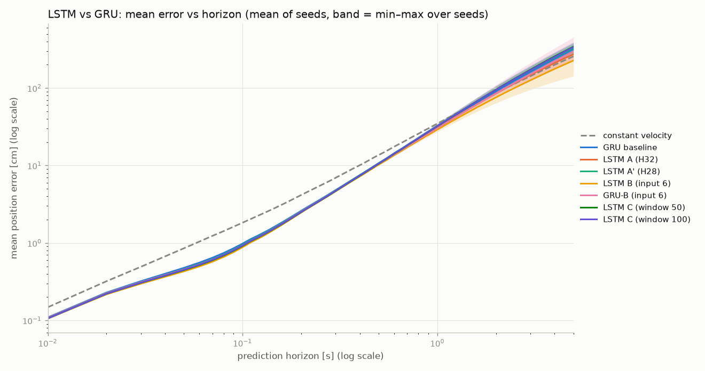
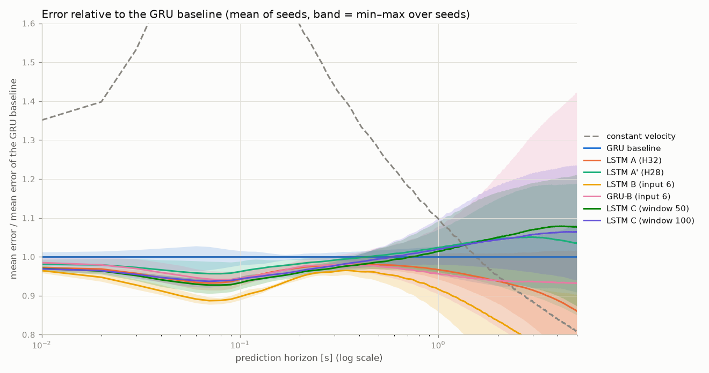

# LSTM vs GRU: results

Benchmark: 20 test trajectories, 83430 prediction origins (measured frames with ≥ 1 s = 100 displacements of history, the same for every model), measured targets only. Errors in cm. Every cell: mean ± std over the seeds (number of seeds in the `seeds` column). Time: one network call, batch 1, one CPU thread (laptop: Bozydar AMD64 Intel64 Family 6 Model 158 Stepping 9, GenuineIntel).

| model | seeds | param. | ADE 0.1 s | FDE 0.1 s | 0.5 s | 1 s | 5 s | time laptop [ms] | time Raspberry [ms] | weights [kB] | epochs (best) |
|---|---|---|---|---|---|---|---|---|---|---|---|
| constant velocity | – | 0 | 0.961 | 1.827 | 13.65 | 34.83 | 256.10 | – | – | – | – |
| GRU baseline | 5 | 4542 | 0.531 ± 0.010 | 0.982 ± 0.015 | 10.68 ± 0.17 | 31.72 ± 0.97 | 316.95 ± 25.65 | 0.794 | not measured yet | 20.3 | 40 (39) |
| LSTM A (H32) | 5 | 5726 | 0.500 ± 0.007 | 0.925 ± 0.014 | 10.47 ± 0.16 | 30.67 ± 0.88 | 272.86 ± 37.07 | 0.252 | not measured yet | 25.0 | 40 (40) |
| LSTM A' (H28) | 5 | 4566 | 0.511 ± 0.009 | 0.945 ± 0.017 | 10.72 ± 0.19 | 32.47 ± 1.30 | 328.00 ± 45.02 | 0.261 | not measured yet | 20.5 | 40 (39) |
| LSTM B (input 6) | 5 | 6110 | 0.478 ± 0.004 | 0.882 ± 0.007 | 10.24 ± 0.17 | 29.08 ± 1.48 | 226.29 ± 61.11 | 0.254 | not measured yet | 26.5 | 40 (38) |
| GRU-B (input 6) | 5 | 4830 | 0.504 ± 0.007 | 0.928 ± 0.012 | 10.43 ± 0.30 | 30.35 ± 2.21 | 295.48 ± 89.23 | 0.789 | not measured yet | 21.5 | 36 (33) |
| LSTM C (window 50) | 5 | 5726 | 0.496 ± 0.007 | 0.917 ± 0.013 | 10.54 ± 0.24 | 32.17 ± 1.79 | 341.30 ± 43.04 | 0.296 | not measured yet | 25.0 | 39 (38) |
| LSTM C (window 100) | 5 | 5726 | 0.501 ± 0.004 | 0.926 ± 0.006 | 10.63 ± 0.20 | 32.35 ± 1.50 | 337.23 ± 43.48 | 0.367 | not measured yet | 25.0 | 37 (34) |

## Decision rule: each variant against the GRU baseline

Difference of the means (variant − GRU baseline) in cm; the variant counts as better or worse only when the difference is larger than the spread between seeds (larger of the two std). Negative = smaller error than the GRU baseline.

| variant | ADE 0.1 s | FDE 0.1 s | 0.5 s | 1 s | 5 s |
|---|---|---|---|---|---|
| LSTM A (H32) | -0.031 (spread 0.010) **better** | -0.057 (spread 0.015) **better** | -0.213 (spread 0.173) **better** | -1.050 (spread 0.974) **better** | -44.092 (spread 37.067) **better** |
| LSTM A' (H28) | -0.020 (spread 0.010) **better** | -0.037 (spread 0.017) **better** | +0.037 (spread 0.185) no difference | +0.756 (spread 1.303) no difference | +11.047 (spread 45.021) no difference |
| LSTM B (input 6) | -0.053 (spread 0.010) **better** | -0.101 (spread 0.015) **better** | -0.441 (spread 0.173) **better** | -2.633 (spread 1.479) **better** | -90.665 (spread 61.108) **better** |
| GRU-B (input 6) | -0.027 (spread 0.010) **better** | -0.054 (spread 0.015) **better** | -0.257 (spread 0.297) no difference | -1.368 (spread 2.214) no difference | -21.472 (spread 89.226) no difference |
| LSTM C (window 50) | -0.035 (spread 0.010) **better** | -0.066 (spread 0.015) **better** | -0.142 (spread 0.238) no difference | +0.454 (spread 1.785) no difference | +24.354 (spread 43.036) no difference |
| LSTM C (window 100) | -0.030 (spread 0.010) **better** | -0.056 (spread 0.015) **better** | -0.057 (spread 0.204) no difference | +0.631 (spread 1.497) no difference | +20.277 (spread 43.478) no difference |

## Specific questions (first model − second model)

| question | ADE 0.1 s | FDE 0.1 s | 0.5 s | 1 s | 5 s |
|---|---|---|---|---|---|
| is the gain of LSTM A due to LSTM or to the larger network? (A' vs A) | +0.011 (spread 0.009) worse | +0.020 (spread 0.017) worse | +0.250 (spread 0.185) worse | +1.805 (spread 1.303) worse | +55.139 (spread 45.021) worse |
| does the acceleration input help the LSTM? (B vs A) | -0.022 (spread 0.007) **better** | -0.044 (spread 0.014) **better** | -0.228 (spread 0.168) **better** | -1.583 (spread 1.479) **better** | -46.573 (spread 61.108) no difference |
| does the acceleration input help the GRU? (GRU-B vs GRU baseline) | -0.027 (spread 0.010) **better** | -0.054 (spread 0.015) **better** | -0.257 (spread 0.297) no difference | -1.368 (spread 2.214) no difference | -21.472 (spread 89.226) no difference |
| same 6 inputs: LSTM vs GRU (B vs GRU-B) | -0.026 (spread 0.007) **better** | -0.046 (spread 0.012) **better** | -0.184 (spread 0.297) no difference | -1.265 (spread 2.214) no difference | -69.193 (spread 89.226) no difference |
| longer window, 50 vs 20 (C50 vs A) | -0.003 (spread 0.007) no difference | -0.009 (spread 0.014) no difference | +0.071 (spread 0.238) no difference | +1.503 (spread 1.785) no difference | +68.446 (spread 43.036) worse |
| longer window, 100 vs 20 (C100 vs A) | +0.001 (spread 0.007) no difference | +0.001 (spread 0.014) no difference | +0.156 (spread 0.204) no difference | +1.681 (spread 1.497) worse | +64.369 (spread 43.478) worse |

