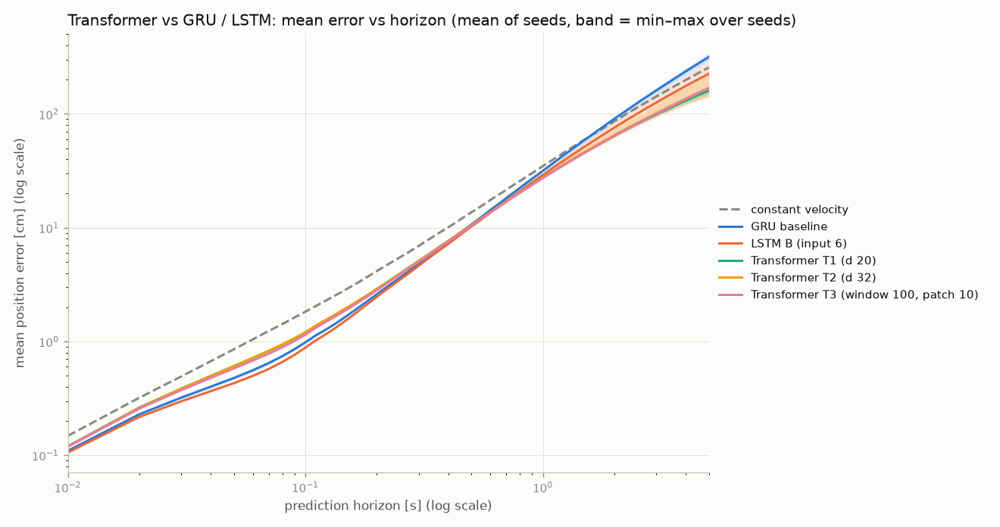
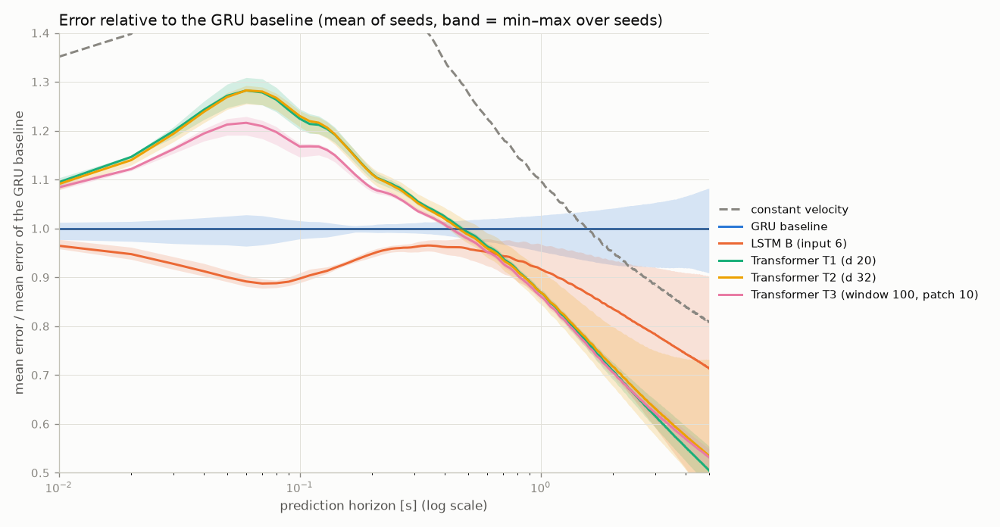

# Transformer vs GRU / LSTM: results

Benchmark: 20 test trajectories, 83430 prediction origins (measured frames with ≥ 1 s = 100 displacements of history, the same for every model), measured targets only. Errors in cm. Every cell: mean ± std over the seeds. GRU baseline and LSTM B come from the LSTM vs GRU study (Results/lstm/), same windows. Time: one network call, batch 1, one CPU thread.

| model | seeds | param. | ADE 0.1 s | FDE 0.1 s | 0.5 s | 1 s | 5 s | time laptop [ms] | time Raspberry [ms] | weights [kB] | epochs (best) |
|---|---|---|---|---|---|---|---|---|---|---|---|
| constant velocity | – | 0 | 0.961 | 1.827 | 13.65 | 34.83 | 256.10 | – | – | – | – |
| GRU baseline | 5 | 4542 | 0.531 ± 0.010 | 0.982 ± 0.015 | 10.68 ± 0.17 | 31.72 ± 0.97 | 316.95 ± 25.65 | 0.794 | not measured yet | 20.3 | 40 (39) |
| LSTM B (input 6) | 5 | 6110 | 0.478 ± 0.004 | 0.882 ± 0.007 | 10.24 ± 0.17 | 29.08 ± 1.48 | 226.29 ± 61.11 | 0.254 | not measured yet | 26.5 | 40 (38) |
| Transformer T1 (d 20) | 5 | 4570 | 0.660 ± 0.008 | 1.203 ± 0.015 | 10.60 ± 0.05 | 27.58 ± 0.21 | 160.10 ± 9.81 | 0.312 | not measured yet | 24.2 | 24 (18) |
| Transformer T2 (d 32) | 5 | 10366 | 0.661 ± 0.007 | 1.208 ± 0.013 | 10.55 ± 0.18 | 27.59 ± 0.86 | 169.47 ± 36.67 | 0.313 | not measured yet | 46.8 | 23 (18) |
| Transformer T3 (window 100, patch 10) | 5 | 4910 | 0.630 ± 0.006 | 1.147 ± 0.012 | 10.46 ± 0.05 | 27.34 ± 0.19 | 168.61 ± 6.12 | 0.295 | not measured yet | 25.5 | 35 (32) |

## Decision rule: each transformer against GRU baseline

Difference of the means (transformer − GRU baseline) in cm; better / worse only when larger than the spread between seeds (larger of the two std). Negative = smaller error.

| variant | ADE 0.1 s | FDE 0.1 s | 0.5 s | 1 s | 5 s |
|---|---|---|---|---|---|
| Transformer T1 (d 20) | +0.129 (spread 0.010) worse | +0.221 (spread 0.015) worse | -0.083 (spread 0.173) no difference | -4.132 (spread 0.974) **better** | -156.849 (spread 25.648) **better** |
| Transformer T2 (d 32) | +0.130 (spread 0.010) worse | +0.226 (spread 0.015) worse | -0.134 (spread 0.183) no difference | -4.124 (spread 0.974) **better** | -147.477 (spread 36.667) **better** |
| Transformer T3 (window 100, patch 10) | +0.099 (spread 0.010) worse | +0.165 (spread 0.015) worse | -0.224 (spread 0.173) **better** | -4.380 (spread 0.974) **better** | -148.345 (spread 25.648) **better** |

## Decision rule: each transformer against LSTM B (input 6)

Difference of the means (transformer − LSTM B (input 6)) in cm; better / worse only when larger than the spread between seeds (larger of the two std). Negative = smaller error.

| variant | ADE 0.1 s | FDE 0.1 s | 0.5 s | 1 s | 5 s |
|---|---|---|---|---|---|
| Transformer T1 (d 20) | +0.182 (spread 0.008) worse | +0.321 (spread 0.015) worse | +0.358 (spread 0.168) worse | -1.499 (spread 1.479) **better** | -66.184 (spread 61.108) **better** |
| Transformer T2 (d 32) | +0.183 (spread 0.007) worse | +0.327 (spread 0.013) worse | +0.307 (spread 0.183) worse | -1.491 (spread 1.479) **better** | -56.812 (spread 61.108) no difference |
| Transformer T3 (window 100, patch 10) | +0.152 (spread 0.006) worse | +0.265 (spread 0.012) worse | +0.217 (spread 0.168) worse | -1.747 (spread 1.479) **better** | -57.680 (spread 61.108) no difference |

## Specific questions (first model − second model)

| question | ADE 0.1 s | FDE 0.1 s | 0.5 s | 1 s | 5 s |
|---|---|---|---|---|---|
| larger transformer, d 32 vs d 20 (T2 vs T1) | +0.001 (spread 0.008) no difference | +0.005 (spread 0.015) no difference | -0.050 (spread 0.183) no difference | +0.008 (spread 0.856) no difference | +9.372 (spread 36.667) no difference |
| 1 s window with patches vs 0.2 s window (T3 vs T1) | -0.030 (spread 0.008) **better** | -0.056 (spread 0.015) **better** | -0.140 (spread 0.052) **better** | -0.248 (spread 0.209) **better** | +8.504 (spread 9.806) no difference |

